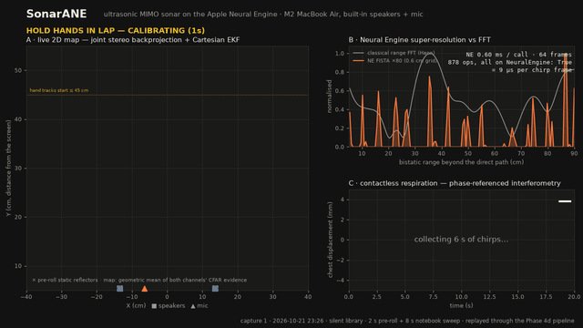
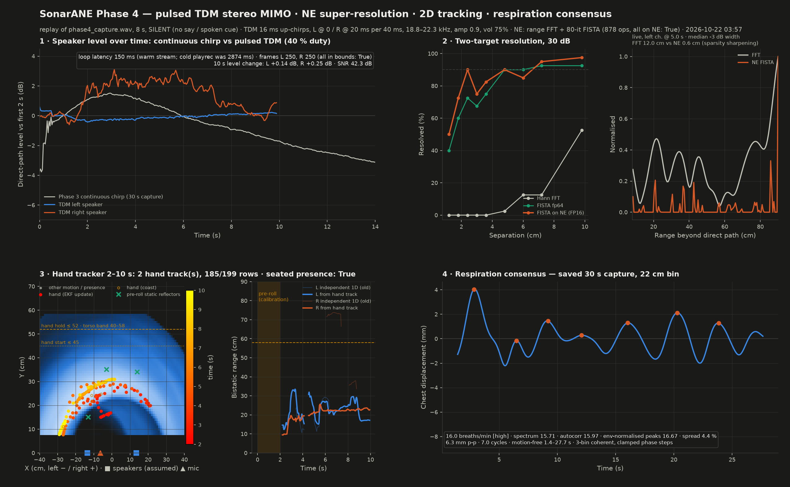
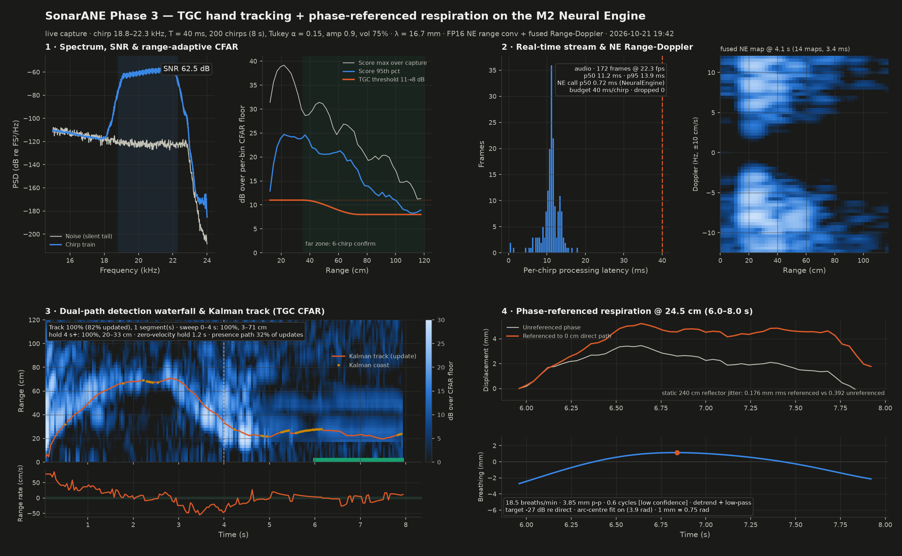
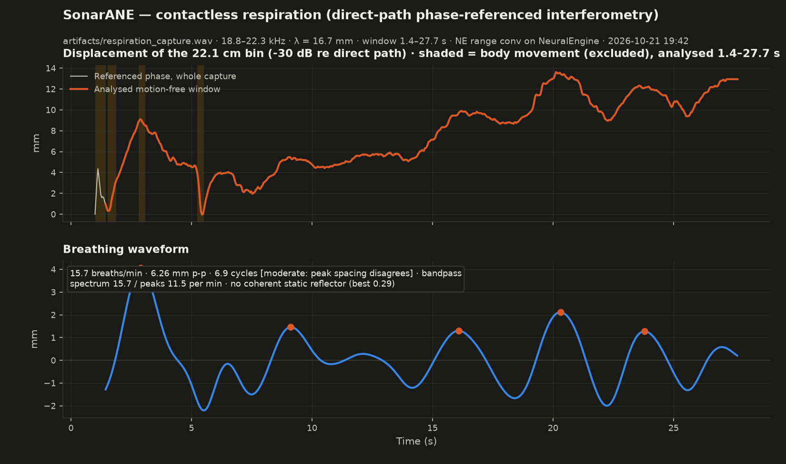

# SonarANE

**Ultrasonic MIMO radar on a stock M2 MacBook Air, with the signal processing running on the Apple Neural
Engine through public CoreML APIs.** The built-in speakers transmit 18.8–22.3 kHz chirps (inaudible, library
safe), the built-in microphone records the echoes, and one CoreML graph of 878 ops does the range FFT and an
80-iteration unrolled FISTA super-resolution for every chirp — all of it scheduled on the NE. On top sit a joint
stereo 2D tracker that follows a hand on a 1 cm (X, Y) grid, a seated-presence detector that recognises a torso by
its ~1 mm breathing micro-motion, and a phase-referenced interferometer that measures chest motion to a fraction of
a millimetre.

No private frameworks, no kernel extensions, no hardware: `coremltools` (MIL Builder → mlprogram → `CompiledMLModel`)
and `sounddevice`.



*Live dashboard replaying the real capture of 2026-10-21 (`artifacts/sonar_ane_demo.mp4`, 60 fps): 2 s hands-in-lap
calibration, then an 8 s notebook sweep. Panel A — 2D map, glowing hand cursor, trail, torso presence ring.
Panel B — NE FISTA profile (orange) vs classical FFT (grey) of the latest chirp. Panel C — respiration.*

## Architecture

```
 built-in speakers (L, R)                                 built-in microphone
 ┌──────────────────────────────────┐                     ┌─────────────────────────┐
 │ pulsed TDM stereo FMCW, 48 kHz   │   air, 0.1–0.6 m    │ 48 kHz, one PRI per     │
 │ L chirp  0–16 ms ┐ 40 ms PRI     │ ──────────────────▶ │ callback block (1920 s.) │
 │ R chirp 20–36 ms ┘ 18.8–22.3 kHz │                     │ fractional-sample frames │
 └──────────────────────────────────┘                     └───────────┬─────────────┘
                                                                      │ 2 × 768-sample chirp frames per PRI
                 ┌────────────────────────────────────────────────────▼────────────────────────────────────┐
                 │  Apple Neural Engine (CoreML mlprogram, FP16, built with the MIL Builder)                │
                 │  ┌──────────────────────────┐  ┌────────────────────────────────────────────────────┐  │
                 │  │ range FFT = fused dechirp │  │ 80-iteration unrolled FISTA on a 0.6 cm grid        │  │
                 │  │ + Hann + DFT as ONE 1×1   │  │ (matched-filter conv, soft threshold as relu pairs, │  │
                 │  │ conv  [1,768,1,S]→[1,128] │  │ momentum adds)   877 ops                            │  │
                 │  └──────────────────────────┘  └────────────────────────────────────────────────────┘  │
                 │  one graph, 878 ops, 0.42 ms per stereo PRI (S=2) · 0.72 ms per 64 frames (S=64)       │
                 │  companion graph: range → MTI → Hann → Doppler → power → smoothing (13 ops, all NE)     │
                 └───────────────┬──────────────────────────────┬───────────────────────────┬─────────────┘
                                 │ complex range spectra        │ sparse range profiles     │ RD maps
          ┌──────────────────────▼───────────────────┐  ┌───────▼─────────────┐  ┌──────────▼───────────┐
          │ pre-roll calibration (2 s hands in lap):  │  │ super-resolution:   │  │ micro-Doppler /      │
          │ static background B0, locked per-bin MTI  │  │ −3 dB width 12 cm → │  │ Range-Doppler cube   │
          │ and presence floors, static reflectors    │  │ 0.6 cm on live data │  └──────────────────────┘
          │ OS-CFAR + range-adaptive (TGC) threshold  │  └─────────────────────┘
          │ joint stereo backprojection on a 1 cm     │
          │ (X, Y) grid → 4-state Cartesian EKF       │  ┌────────────────────────────────────────────────┐
          │ observing (R_L, R_R) with range-Doppler   │  │ direct-path phase-referenced interferometry:   │
          │ coupling → hand / seated-presence split   │  │ 3-bin coherent chest signal, clamped phase     │
          └───────────────────────────────────────────┘  │ steps, three-way rate consensus → breaths/min  │
                                                         └────────────────────────────────────────────────┘
```

## Measured results (M2 MacBook Air, coremltools 9.0, numbers from `artifacts/*.json`)

### Neural Engine graphs

| graph | ops | placement (`MLComputePlan`) | time per call | throughput | vs NumPy on the same Mac |
|---|---|---|---|---|---|
| range FFT as a 1×1 conv, 64 chirps/call | 1 | NeuralEngine | 0.47 ms | 119 810 chirps/s (2 408× real time) | same conv at S=1 is placed on the CPU: 62 µs/chirp |
| fused range → MTI → Doppler → power → smoothing, 16 × 64 chirps | 13 | all NeuralEngine | 1.10 ms | 928 412 chirps/s | 21.6× the NumPy FFT pipeline, 1.67× an Accelerate GEMM pipeline, 51 % less CPU |
| unrolled FISTA ×80 super-resolution, 64 frames | 877 | all NeuralEngine | 0.50 ms | 127 000 frames/s | **20.0×** NumPy fp32 + Accelerate (10.06 ms); FP16 rel. error 0.089 |
| MIMO graph: range FFT + FISTA, two inputs / two outputs, 64 frames | 878 | all NeuralEngine | 0.72 ms steady state (11 µs per frame) | — | the 768-sample range conv alone never leaves the CPU; fused into the FISTA graph it runs on the NE |
| the same MIMO graph at S=2 (one stereo PRI, the live app) | 878 | all NeuralEngine | 0.42 ms bench · 1.26 ms p50 inside the live stream | 25 PRIs/s needed | — |

### Radar

| what | result |
|---|---|
| waveform | pulsed TDM stereo FMCW: L chirp 0–16 ms, R chirp 20–36 ms of every 40 ms PRI, 3.5 kHz sweep, 40 % duty per speaker, 4.9 cm FFT resolution |
| stereo isolation (simulated, 30 ms room tail) | TDM −37.7 dB max / −53.4 dB median, vs −14.2 dB for up/down-chirp CDM |
| speaker level stability | TDM 10 s capture: L +0.14 dB, R +0.25 dB; a continuous chirp sagged −5.2 dB over 28 s |
| two-target resolution, 90 % resolved at 30 dB SNR | FFT: not within the tested 1.2–9.8 cm (52 % at 9.8 cm); FISTA fp64 4.8 cm; FISTA on the NE (FP16) 7.2 cm |
| live main-peak −3 dB width (67 real chirps) | FFT 12.0 cm → NE FISTA 0.6 cm |
| 2D hand tracking, real capture 2026-10-21 23:26 (2 s pre-roll + 8 s notebook sweep, silent library) | hand track on **185 / 199 rows (93 %)**, X −29…+21 cm, Y 8…31 cm, first hand row 0.2 s after the cue; the same recording without the pre-roll calibration: 7 % |
| 2D tracking, simulation (measured geometry, right direct path −19 dB) | 100 % coverage, X error 2.5 cm / Y 1.0 cm median; **0 / 5** empty scenes produce a hand track; 3 / 3 seated-torso scenes report presence |
| seated presence, real capture | torso statics at (−3, 35) and (14, 34) cm with 0.9–1.4 mm rms micro-motion, 58–92 % of the power in the 0.12–0.6 Hz respiration band → `seated_presence_detected: true` |
| respiration, 30 s seated capture (book on chest) | **15.97 breaths/min, high confidence** (spectrum 15.71 · autocorrelation 15.97 · envelope-normalised peaks 16.67, spread 4.4 %), 6.3 mm p-p, 7.0 cycles, chest at 22 cm |
| live stream, real audio, 12 s | 21.5 PRIs/s processed, block→track latency 9.9 ms p50 / 13.4 ms p95, 0 dropped blocks |
| 1-D tracker (Phase 3, 8 s capture) | 100 % coverage, 82 % of rows updated (rest coasted); simulated −36 dB hand: 1.97 cm rms |


*Phase 4: speaker stability, two-target resolution, the calibrated hand tracker on the real sweep, respiration consensus.*


*Phase 3: NE range conv, range-adaptive CFAR tracker, fused Range-Doppler cube, breathing.*


*30 s respiration capture: direct-path phase-referenced chest displacement and the three-way rate consensus.*

## How it works, briefly

1. **Dechirp + range DFT as one matrix.** For an FMCW chirp the beat-frequency DFT of the dechirped signal is a
   linear map of the raw samples: `W ∈ R^{2K×N}` (real/imaginary rows, Hann-windowed, zero-padded). CoreML sees
   it as a 1×1 convolution with `N` input channels and `2K` output channels on a `[1, N, 1, S]` tensor; the
   planner puts it on the NE for banks of S ≥ 8. Every frame is normalised to [−1, 1] before the FP16 cast.
2. **Pulsed TDM stereo.** Each speaker gets its own 16 ms slot in a 40 ms PRI, so the two channels separate in
   time instead of code (−38 dB vs −14 dB) and the speakers run at 40 % duty, which is what stopped the
   continuous-chirp level sag. Frames are cut at fractional sample starts from a per-channel clock fit;
   rounding to whole samples made every bin jump 2.7 rad each time the grid slipped a sample.
3. **FISTA on the NE.** The soft threshold `sign(v)·max(|v|−λ, 0)` is `relu(v−λ) − relu(−v−λ)`; the matched
   filter and the Gram operator are convs; 80 iterations with Nesterov momentum unroll into 877 ops. The NE
   runs it 20× faster than NumPy on the same chip and sharpens a 12 cm FFT peak to 0.6 cm on real echoes.
4. **Pre-roll calibration.** Every capture chirps for 2 s while the hands rest in the lap: static background,
   per-bin noise floors (median, bounded below) and the static scene are locked from that window, so a
   continuous sweep can no longer raise its own CFAR floor.
5. **Joint 2D tracking.** Per-channel CFAR evidence is backprojected on a 1 cm grid as the geometric mean of
   both channels (a ghost in one channel has no partner at the consistent range), and a 4-state EKF observes
   both bistatic ranges jointly with the up-chirp range-Doppler coupling in the measurement model.
   Multi-hypothesis initiation; a kinematic gate separates a hand (starts ≤ 45 cm, moves ≥ 6 cm, ≥ 0.5 s)
   from the seated torso (static reflector at 25–55 cm whose range bins breathe).
6. **Respiration.** Every chirp is referenced to the direct-path phase (timing error cancels), three range
   bins are combined coherently, phase increments are clamped and amplitude-gated, and the rate is the median
   of a spectral, an autocorrelation and an envelope-normalised-peak estimate.

## Run it

```bash
~/SonarANE/.venv/bin/python ane_kernels/ane_radar_benchmark.py      # range models + benchmark (~2 min)
~/SonarANE/.venv/bin/python ane_kernels/ane_fused_2d_radar.py       # fused RD graph + benchmark
~/SonarANE/.venv/bin/python ane_kernels/ane_superres_mimo.py        # FISTA + MIMO graphs, resolution test
~/SonarANE/.venv/bin/python src/live_radar_app.py                   # live showcase window (chirps only, silent)
~/SonarANE/.venv/bin/python src/live_radar_app.py --sim             # same window on a synthetic scene, no audio
~/SonarANE/.venv/bin/python src/live_radar_app.py --demo-from-wav   # render artifacts/sonar_ane_demo.mp4 + .gif
~/SonarANE/.venv/bin/python tests/live_phase4_mimo_superres.py      # 2 s pre-roll + 8 s sweep capture → dashboard
~/SonarANE/.venv/bin/python tests/joint2d_validation.py             # silent regression: sims + saved captures
```

Python 3.12 venv with `coremltools 9.0`, `numpy` (Accelerate BLAS), `scipy`, `sounddevice`, `matplotlib`,
`imageio-ffmpeg` (video). Audio devices are selected by name (`MacBook Air Microphone/Speakers`). Live scripts
save, set (75 %) and restore the output volume and mute state. All cues are on screen; nothing audible is
ever played.

## Layout

| path | what |
|---|---|
| `src/fmcw.py` | chirp, fused dechirp+DFT kernel, MTI, OS-CFAR, TGC threshold, dual-path Kalman tracker, respiration |
| `src/mimo.py` | TDM stereo waveform, 768-sample kernel, gain normalisation, backprojection, `JointEKF`, pre-roll calibration, hand / seated-presence pipeline, micro-motion torso check |
| `src/live_radar_app.py` | the showcase: live engine (S=2 NE graph, streaming EKF, presence, breathing), three-panel dashboard, `--demo-from-wav` renderer |
| `src/live_radar_app_phase3.py` | the earlier continuous-chirp 1-D live app |
| `src/visual_cue.py` | silent on-screen countdown window |
| `ane_kernels/ane_radar_benchmark.py` | range-FFT conv models, compute-plan check, benchmark |
| `ane_kernels/ane_fused_2d_radar.py` | fused Range-Doppler graph, benchmark |
| `ane_kernels/ane_superres_mimo.py` | FISTA dictionary, NE graphs, two-target resolution test |
| `tests/live_phase4_mimo_superres.py` | silent warm-stream TDM capture, analysis, Phase 4 dashboard + telemetry |
| `tests/joint2d_validation.py`, `tests/tracker_validation.py` | silent regressions on simulations and saved captures |
| `artifacts/` | telemetry JSON, dashboards, the two captures the demo replays, demo video |
| `MEMORY.md`, `.claude/skills/ultrasonic-fmcw-radar/SKILL.md` | measured lessons per phase; the maths and CoreML conventions |

## Known limits (read before quoting the numbers)

- The 0.5 s minimum gesture length was chosen knowing that the library "hands off" baseline contained one
  0.36 s false track, so that baseline's 0 false hand tracks is not a blind result. Real hand evidence sits only
  1.3–6 dB above the CFAR threshold.
- One of three simulated seated-torso scenes still produces two short ghost hand tracks.
- The speaker spacing (27 cm) is assumed, not measured; the mic offset comes from the two direct-path delays.
  X errors of a few cm follow from that. The live engine's integer-sample direct-path search gave −2.1 cm
  where the offline fit gives −6.4 cm.
- The respiration capture is a single-speaker continuous-chirp recording (range only); the demo video says so.
  Its breaths/min readout in the video is a causal estimate on the data so far: it wanders between 9 and
  18/min for the first ~22 s (the first breaths were irregular) before settling on the 16.0/min consensus.
- Everything was measured in one room on one machine; CoreML's op placement is decided per tensor shape and
  can differ on other hardware or OS versions (`MLComputePlan` is checked at load time).
